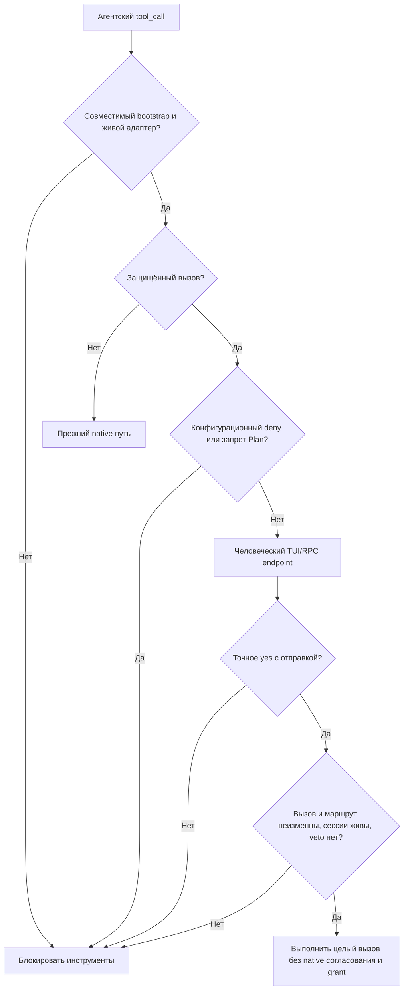

# ADR 0003: Усиленное согласование опасных вызовов

Status: accepted

## Контекст

Штатного выбора в permission-system недостаточно для опасных команд: нужен заметный красный UI с вводом слова, а не один Enter. Защищённый вызов не должен после этого проходить второй штатный диалог или сохраняться как grant. Обычные вызовы должны сохранить существующие правила, настройки, UI и YOLO.

Прежний ADR 0001 делает пользовательские `allow` важнее значений набора. Пользователь согласовал исключение: распознанные локальные удаления, все Hadoop/HDFS вызовы и изменяющий/неизвестный SQL поддерживаемых клиентов требуют усиленного согласования независимо от `allow`, YOLO и grants. Применимый конфигурационный `deny` и настоящая политика Plan mode окончательны.

## Решение

Классификатор, SQL-анализ, policy projection, UI и межсессионный брокер принадлежат Datalab Kit. Встроенная библиотека остаётся строго 33.0.5, контракт адаптера — v1. Не создаём собственный fork: `prepare-upstream.mjs` применяет небольшую интеграционную адаптацию к поставляемой версии, проверяя версию и единственность anchors. Изменяются только зависимости набора, не глобальный Pi или самостоятельно установленная библиотека пользователя.

Native bash pipeline отдаёт собственному классификатору уже разобранное дерево до его освобождения. Защищённый вызов получает отдельные проверки конфигурационных запретов команд/путей, фактического Plan mode и человеческого ввода. Результат сразу разрешает или блокирует целый неизменённый вызов, не входя в обычный gate runner, judges и хранилище решений. Для остальных вызовов native путь остаётся прежним.

Разбираем известные вложенные исполнители, а не только внешний executable. Флаги обёртки отделены от флагов вложенной команды; `command`/`builtin` подавляют lookup функции только для непосредственно запускаемого имени, не для последующего `eval`. Background/process cwd не меняет cwd вызывающего shell. Неизвестные operands и генерируемые аргументы сохраняются как неизвестные; известный опасный head не теряется. Для SQL-заданий это исключает недоказанное read-only освобождение.

Любой `git clean` без доказанного dry-run считаем потенциальным удалением: требование `-f` может быть отключено настройкой repository/global/env. Не проверяем только дефолт Git и не используем отсутствие `-f` как признак безопасности.

Пути Git учитывают отдельные `-C` последовательно и явно заданный `--work-tree`. Простые quoted ссылки `"$NAME"`/`"${NAME}"` на известные bindings дают дополнительные path/raw-command evidence; они вычисляются до временных assignment текущего вызова и сохраняются через `env -S`, find/fd и template-исполнители. Для templates неизвестный основной разбор сохраняется рядом с дополнительной evidence, чтобы не доказать безопасность по неполному входу. Динамические executable не раскрываются; исходно неизвестные SQL-аргументы и dry-run flags остаются неизвестными. Evidence не переписывает исполняемый вызов.

### UI и жизненный цикл

Крупный красный inline-блок использует рамку, padding и выделенный заголовок, не overlay. Показывает весь вызов и причины, инициатора и cwd. Ввод строго raw `yes`: неверный ответ остаётся редактируемым, Esc/Ctrl-C/abort/dispose означают отказ. Длинный disclosure просматривается Ctrl+PgUp/PgDn: fullscreen Pi перехватывает unmodified page keys для viewport. RPC использует текстовый `ui.input`; без доступного интерфейса вызов блокируется.

Одобрение связывается со всеми входными параметрами конкретного вызова. После ожидания повторно проверяются veto, роль, маршрут и жизнеспособность сессий. Нового разрешения на сессию нет. Каждый защищённый вызов требует отдельного ответа.

### Субагенты

Брокер следует фактическому native маршруту родителей до живого человеческого endpoint, в том числе через промежуточных субагентов. Каждый участник применяет свои конфигурационные запреты и Plan до UI и после ответа. Родительские обычные `allow`/YOLO и judge не отвечают за человека; локальный UI субагента не является fallback.

Внутри процесса используются живые Pi session managers; между процессами — приватные каталоги/файлы с привязкой к версии, запросу/digest, реальному инициатору, маршруту и поколению сессии. Запросы сериализуются у человека; timeout десять минут. Нет родителя, сменился маршрут, закрылась сессия, неверный response binding или отказ policy integration — блокировать.

### Независимая проверка готовности

`security-extension.ts` регистрирует первый `tool_call` handler независимо от host-backed runtime. Проверяются фактическая версия установленного пакета, версия readiness capability и readiness конкретного session manager. Runtime публикует capability через process-global Symbol; callback остаётся false до совместимой native регистрации и старта сессии. Bootstrap не делает native dynamic import runtime: в установленном архиве это обходило бы SDK aliases Jiti.

Если библиотека отсутствует/обновлена до неподдерживаемой версии, native pipeline потерял маркер контракта, отсутствует метод получения классификации в native BashProgram или adapter registration не работает, блокируются все агентские инструменты. Маркер готовности pipeline зависит и от наличия этого метода; повреждённая интеграция не возвращает старый менее строгий путь.

## Обновления и последствия

- Отдельное обновление встроенного permission-system не поддерживается. Переход на версию выполняется в Datalab Kit: обновить pin/anchors и контракт при его изменении, проверить native tool_call, forwarding, UI, обычные вызовы и установку настоящего архива.
- Сборка прекращается при несовпадении версии/anchor. Runtime guard даёт fail-closed поведение при несовместимой или частичной установке, а не обещает совместимость с произвольной новой библиотекой.
- GigaChat остаётся независимо обновляемым по ADR 0002. Host SDK не дублируется в bundled kit; используется интерфейс установленного Pi.
- ADR 0001 остаётся действующим для остальных вызовов, штатного диалога и числа субагентов. Историческое собственное ordinary-согласование из 0.1.1 не возвращается.

## Доверенная граница

Это слой согласования известных операций, не sandbox. Непрозрачные скрипты, Python, динамические имена команд, другие SQL-клиенты/MCP и явный ручной bash сохраняют native поведение. Доверяем расширениям, launcher, TUI/RPC клиенту и локальным процессам/IPC с правами пользователя: нельзя защититься от произвольного исполняемого кода или враждебного процесса того же UID только этими hooks и файлами. RPC ответ доверенного клиента не доказывает физическое присутствие человека у клавиатуры.

SQL-клиенты и определения на сервере доверены; анализ не доказывает отсутствие скрытого эффекта у view/оператора/функции. Известный безопасный SQL определяется консервативно; неизвестный эффект поддерживаемого клиента защищён.

Не снимаем snapshot всех исполняемых файлов, SQL inputs, окружения, симлинков или внешнего состояния. Одобрение неизменённого вызова не гарантирует неизменность содержимого его источников и целей. Для более сильной границы нужны права ОС/БД/кластера или sandbox, а не расширение этого UI.

## Проверка

Согласованные seams: публичные classifier и UI input/render, реальные Pi tool_call и межсессионная/межпроцессная передача. Регрессии покрывают typed exactness, YOLO/grants, финальность deny/Plan, изменение запроса/маршрута, очередь и закрытие сессий. Установочный тест проверяет настоящий npm-архив, headless-защиту и несовместимый/частичный контракт. Smoke использует настоящий Bash executor только над временными файлами и настоящий regular/fullscreen Pi TUI.
